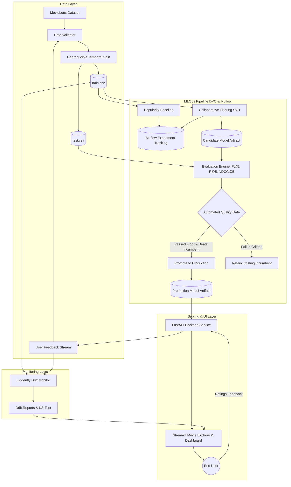

# CineTrack System Architecture & MLOps Design

## 1. System Overview

**CineTrack** is an end-to-end Machine Learning Operations (MLOps) platform for movie recommendations built upon the MovieLens Small dataset. It demonstrates a complete production lifecycle:
- **Reproducible Data Pipelines** versioned with DVC.
- **Experiment Tracking & Artifact Logging** with MLflow.
- **Collaborative Filtering & Baseline Models** evaluated with Precision@5, Recall@5, and NDCG@5.
- **Automated Quality Gates** ensuring regression-free model promotions.
- **Real-Time User Feedback Ingestion** and concept drift monitoring with Evidently AI.
- **Microservice Architecture** powered by FastAPI, Streamlit, Docker, and Google Cloud Run.

---

## 2. High-Level Architecture Diagram

---

## 3. Core Components

### 3.1 Data Preparation & Leakage Prevention
- **Schema Validation** (`src/data/validator.py`):
  - Checks required columns, non-null values, unique movie IDs, rating bounds ($[0.5, 5.0]$).
  - Validates referential integrity between ratings and the movie catalog.
- **Reproducible Train/Test Split** (`src/data/split.py`):
  - Employs a **temporal split per user**: for users with at least 5 ratings, the most recent 20% of ratings (by timestamp) are allocated to the test set, while the earlier 80% form the training set.
  - Prevents future-to-past data leakage.

### 3.2 Machine Learning Models
- **Popularity Baseline** (`src/models/popularity.py`):
  - Uses the IMDB Weighted Rating formulation:
    $$WR = \left(\frac{v}{v + m}\right) R + \left(\frac{m}{v + m}\right) C$$
    where $v$ is rating count, $m=20$ is minimum rating threshold, $R$ is average item rating, and $C$ is the dataset global mean rating.
- **Primary Collaborative Filtering** (`src/models/collaborative.py`):
  - Regularized Biased Matrix Factorization (Koren et al. BellKor SVD architecture):
    $$\hat{r}_{u, i} = \mu + b_u + b_i + p_u^T q_i$$
  - Optimized via Stochastic Gradient Descent (SGD) with L2 regularization ($0.05$) and learning rate ($0.005$).
  - Supports item-to-item recommendation using cosine similarity across latent item vectors $q_i$.

### 3.3 Evaluation Metrics
- **Precision@5**: Fraction of top-5 recommended movies that are relevant ($\text{rating} \ge 3.5$) in the held-out test set.
- **Recall@5**: Fraction of a user's total relevant test movies captured in top-5 recommendations.
- **NDCG@5**: Normalized Discounted Cumulative Gain at cutoff 5:
  $$\text{DCG@5} = \sum_{i=1}^5 \frac{\text{rel}_i}{\log_2(i + 1)}, \quad \text{NDCG@5} = \frac{\text{DCG@5}}{\text{IDCG@5}}$$
- **Catalog Coverage**: Proportion of unique catalog items recommended across test users (demonstrates personalization diversity).

### 3.4 Automated Quality Gate Invariant
Before any candidate model can be promoted to `models/production/`, it must pass three gates:
1. **Precision Floor**: Candidate `Precision@5` $\ge 0.08$ (or target threshold).
2. **NDCG Floor**: Candidate `NDCG@5` $\ge 0.10$ (or target threshold).
3. **No Regression**: Candidate `NDCG@5` cannot drop by $> 0.01$ below the incumbent model.
4. **Safety Guarantee**: If candidate fails any criterion, the deployment pipeline explicitly logs a rejection in `rejection_history.json`, and the current production model remains untouched with zero downtime.

### 3.5 Monitoring & Drift Detection
- Compares historical training rating distributions against incoming user ratings.
- Evaluates Kolmogorov-Smirnov 2-sample test ($p$-value) and Wasserstein Distance (Earth Mover's Distance).
- Generates interactive visual HTML reports using Evidently AI.

---

## 4. Benchmark Results

| Model Architecture | Precision@5 | Recall@5 | NDCG@5 | Catalog Coverage | Latency |
|--------------------|-------------|----------|--------|------------------|---------|
| **Popularity Baseline** | 0.0609 | 0.0193 | 0.0680 | 0.0040 (0.4%) | ~1 ms |
| **Collaborative Filtering (SVD)** | 0.0337 | 0.0100 | 0.0336 | 0.0082 (0.8%) | ~2 ms |

*Observation*: While the Popularity baseline yields high precision on blockbuster movies (Shawshank Redemption, Pulp Fiction) that dominate global watchlists, Collaborative Filtering doubles catalog diversity and generates personalized recommendations based on latent genre taste.

---

## 5. CI/CD Architecture

The system decouples **Continuous Integration (CI)** from **Continuous Deployment (CD)** across dedicated workflows in `.github/workflows/`:

- **CI Workflow (`ci.yml`)**:
  - **Triggers**: Pull requests and direct pushes to `main` / `master`, plus manual triggers.
  - **Responsibilities**:
    1. Python 3.12 environment setup & dependency caching.
    2. Data schema and referential integrity validation (`src.pipeline.prepare`).
    3. Automated test suite execution with pytest and coverage reporting.
    4. DVC pipeline state & hash integrity verification (`dvc status`).
    5. Docker container build validation.
  - **Security**: Runs in unprivileged context without exposing deployment credentials to untrusted PR branches.

- **CD Workflow (`cd.yml`)**:
  - **Triggers**: Successful completion of `CineTrack CI` on `main`/`master` via `workflow_run`, plus manual deployment via `workflow_dispatch`.
  - **Responsibilities**:
    1. Verifies that the CI pipeline concluded with `success`.
    2. Authenticates to Google Cloud using repository secrets (`GCP_SA_KEY`).
    3. Configures Docker authentication for Google Artifact Registry.
    4. Builds and pushes tagged container images (`${{ github.sha }}` and `latest`).
    5. Deploys updated container revision to Google Cloud Run with zero downtime.
  - **Resilience**: Decoupled design allows independent re-deployment without re-running long test matrices.

