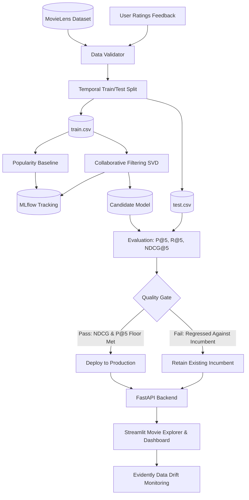

# CineTrack: MLOps-Based Movie Recommendation System

[](https://cinetrack-119150568663.us-central1.run.app)
[](https://github.com/samarthsb4real/MLOps/actions/workflows/ci.yml)
[](https://github.com/samarthsb4real/MLOps/actions/workflows/cd.yml)
[](https://github.com/samarthsb4real/MLOps)


-brightgreen.svg)

---

### Project Links
- **Live Cloud Web App**: **[https://cinetrack-119150568663.us-central1.run.app](https://cinetrack-119150568663.us-central1.run.app)**
- **GitHub Repository**: **[https://github.com/samarthsb4real/MLOps](https://github.com/samarthsb4real/MLOps)**
- **CI/CD Automated Testing**: **[GitHub Actions](https://github.com/samarthsb4real/MLOps/actions)**
- **GCP Cloud Run Service**: `cinetrack` (`us-central1`, Project: `affable-radio-473308-v9`)

---

**CineTrack** is an end-to-end Machine Learning Operations (MLOps) movie recommendation system built upon the MovieLens Small dataset. It demonstrates a complete production lifecycle: from automated data validation, baseline vs collaborative filtering model training, and MLflow experiment tracking to DVC pipeline reproduction, Evidently data drift monitoring, automated retraining with quality-gated model promotion, Docker containerization, CI/CD, and Google Cloud Run deployment.

---

## Key Highlights

- **Machine Learning Core**:
  - **Baseline**: IMDB Weighted Rating Popularity Recommender.
  - **Primary Model**: Regularized Biased Matrix Factorization (Koren SVD) with latent user and item factors.
  - **Item-to-Item Similarity**: Real-time cosine similarity across latent vectors for context-aware movie recommendations.
  - **Evaluation Metrics**: `Precision@5`, `Recall@5`, `NDCG@5`, and catalog coverage on a leak-free temporal split.
- **MLOps Lifecycle**:
  - **DVC**: Multi-stage reproducible pipeline (`prepare` $\rightarrow$ `train` $\rightarrow$ `evaluate`) tracked via `dvc.yaml` and `dvc.lock`.
  - **MLflow**: Centralized experiment tracking logging parameters, loss, Precision/NDCG metrics, and model artifacts with SQLite backend.
  - **Automated Quality Gate**: Evaluates candidate models against the incumbent production model. An underperforming model is **rejected** and the incumbent is retained with zero downtime.
  - **Monitoring & Concept Drift**: Uses Evidently AI and Kolmogorov-Smirnov statistical divergence tests to monitor incoming user ratings against training baselines.
- **Microservices & UI**:
  - **FastAPI**: REST API with OpenAPI documentation for movie browsing, search, recommendations, feedback ingestion, model status, and retraining.
  - **Streamlit**: Sleek, modern dark-themed web application featuring **Movie Explorer** and a full-featured **MLOps Dashboard**.
  - **CI/CD**: GitHub Actions workflow running tests, DVC dry-runs, Docker builds, and Cloud Run deployments.

---

## Architecture Diagram



---

## Project Structure

```
MLOps/
├── data/
│   ├── raw/                  # Ingested raw MovieLens dataset
│   ├── processed/            # Leak-free train.csv, test.csv, movies.csv
│   └── feedback/             # Incoming real-time user ratings stream
├── deploy/
│   └── cloud_run_deploy.sh   # 1-click Google Cloud Run deployment script
├── models/
│   ├── baseline/             # Popularity baseline model & metrics
│   ├── candidates/           # Staged candidate models & quality reports
│   └── production/           # Deployed incumbent model & promotion history
├── reports/
│   └── drift/                # Evidently HTML and JSON drift reports
├── src/
│   ├── api/                  # FastAPI endpoints & Pydantic schemas
│   ├── data/                 # Data loader, schema validator, temporal split
│   ├── evaluation/           # Precision@5, Recall@5, NDCG@5 metrics
│   ├── models/               # BaseRecommender, Popularity, Collaborative SVD
│   ├── monitoring/           # Evidently data drift analysis
│   ├── pipeline/             # prepare, train, evaluate, and quality gate
│   └── ui/                   # Streamlit Movie Explorer & MLOps Dashboard
├── tests/                    # Automated pytest suite (16 tests)
├── .github/workflows/        # GitHub Actions CI/CD pipeline
├── Dockerfile                # Production multi-mode container
├── docker-compose.yml        # Local multi-service composition
├── dvc.yaml                  # DVC data and model pipeline stages
├── params.yaml               # Pipeline hyperparameter configurations
├── requirements.txt          # Frozen reproducible dependencies
└── README.md                 # Project documentation
```

---

## Quickstart & Local Reproduction

### 1. Environment Setup

```bash
# Clone the repository
git clone https://github.com/samarth/MLOps.git
cd MLOps

# Create and activate Python virtual environment
python3 -m venv .venv
source .venv/bin/activate

# Install dependencies
pip install -r requirements.txt
```

### 2. Run Data Ingestion & Leak-Free Split

```bash
python -m src.pipeline.prepare
```
*Validates schema, performs temporal split per user, and writes `data/processed/train.csv` and `test.csv`.*

### 3. Run Reproducible DVC Pipeline

```bash
dvc repro
```
*Executes all stages (`prepare`, `train`, `evaluate`) and produces locked metrics in `dvc.lock`.*

Inspect metrics with:
```bash
dvc metrics show
```

### 4. Run Automated Test Suite

```bash
pytest tests/ -v
```
*Executes all 16 tests covering data schema validation, split reproducibility, recommendation ranking, API endpoints, and quality gate invariants.*

---

## Running the Web Application

### Option A: Run Locally via Python

**Terminal 1 — FastAPI Backend:**
```bash
source .venv/bin/activate
uvicorn src.api.app:app --host 0.0.0.0 --port 8000 --reload
```
Interactive Swagger docs: **http://localhost:8000/docs**

**Terminal 2 — Streamlit UI:**
```bash
source .venv/bin/activate
streamlit run src/ui/app.py --server.port 8501
```
Web Interface: **http://localhost:8501**

### Option B: Run with Docker Compose

```bash
docker-compose up --build
```
- Streamlit UI: **http://localhost:8501**
- FastAPI Backend: **http://localhost:8000**
- Healthcheck: `http://localhost:8000/health`

---

## MLOps Evaluation & Demonstration Walkthrough

### 1. Movie Explorer
1. Navigate to **http://localhost:8501** $\rightarrow$ **🎬 Movie Explorer**.
2. Browse movies, search by title (e.g. *Toy Story*, *Inception*), or filter by genre.
3. Select any movie to view its 5 most similar movies computed using latent cosine similarity.
4. Rate a movie (e.g. 4.5★) to submit real-time user feedback into `data/feedback/`.

### 2. MLOps Dashboard
1. Switch to **📊 MLOps Dashboard**.
2. Inspect live model evaluation metrics (`Precision@5`, `Recall@5`, `NDCG@5`, and catalog coverage).
3. View the **Production Incumbent vs Candidate** staging comparison.
4. Examine the **Automated Quality Gate Audit Log** with timestamps and reasons.
5. Review the **MLflow Experiment Runs** logged directly in SQLite.

### 3. Automated Retraining & Quality Gate Promotion
1. Switch to **🔄 Retraining & Pipeline**.
2. Adjust hyperparameters (latent factors, epochs, learning rate).
3. Click **🚀 Trigger Candidate Training & Quality Gate**:
   - The candidate model trains on all ratings plus accumulated feedback.
   - The quality gate tests if candidate `Precision@5` and `NDCG@5` satisfy criteria and don't regress against the incumbent.
   - If passed $\rightarrow$ Candidate is promoted to production (`models/production/`).
   - If failed $\rightarrow$ Candidate is rejected and the incumbent model remains unchanged.

### 4. Evidently AI Data Drift Monitoring
1. Switch to **📈 Drift & Monitoring**.
2. Click **🔍 Run Live Data Drift Analysis Now**.
3. View the Kolmogorov-Smirnov test $p$-value and Wasserstein distance between reference training ratings and current user feedback.
4. Interact with the full visual **Evidently AI HTML Report** embedded directly in the dashboard.

---

## Google Cloud Run Deployment

CineTrack is fully containerized and deployed to **Google Cloud Run**:

- **Live URL**: **[https://cinetrack-119150568663.us-central1.run.app](https://cinetrack-119150568663.us-central1.run.app)**
- **GCP Project ID**: `affable-radio-473308-v9`
- **Region**: `us-central1`
- **Service Name**: `cinetrack`

To deploy updates to Google Cloud Run in one command:

```bash
# Set your GCP Project ID
export GCP_PROJECT_ID="affable-radio-473308-v9"
export GCP_REGION="us-central1"

# Execute the deployment script
./deploy/cloud_run_deploy.sh
```

The script enables Cloud Run and Container Registry APIs, builds the container via Cloud Build, deploys the unified service listening on `$PORT` (8080), and outputs the live HTTPS endpoint.

---

## Automated Test Coverage

The test suite validates every layer of the MLOps lifecycle:

- `tests/test_data.py`: Schema validation, rating bounds, duplicate handling, temporal split leak-prevention.
- `tests/test_models.py`: Popularity baseline, collaborative SVD fitting, score prediction, model persistence.
- `tests/test_metrics.py`: Precision@K, Recall@K, NDCG@K mathematical correctness.
- `tests/test_pipeline.py`: End-to-end data preparation, training, evaluation, and bootstrap staging.
- `tests/test_api.py`: FastAPI endpoints (health, catalog, search, recommendations, feedback, metrics, drift).
- `tests/test_promotion.py`: Quality gate promotion criteria and **retention invariant** (guaranteeing that an inferior candidate never replaces the incumbent production model).

Run tests with coverage:
```bash
pytest tests/ -v --cov=src --cov-report=term-missing
```
